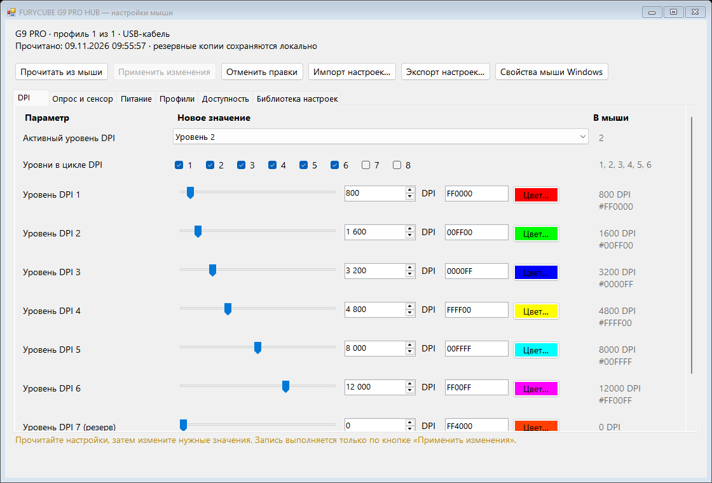
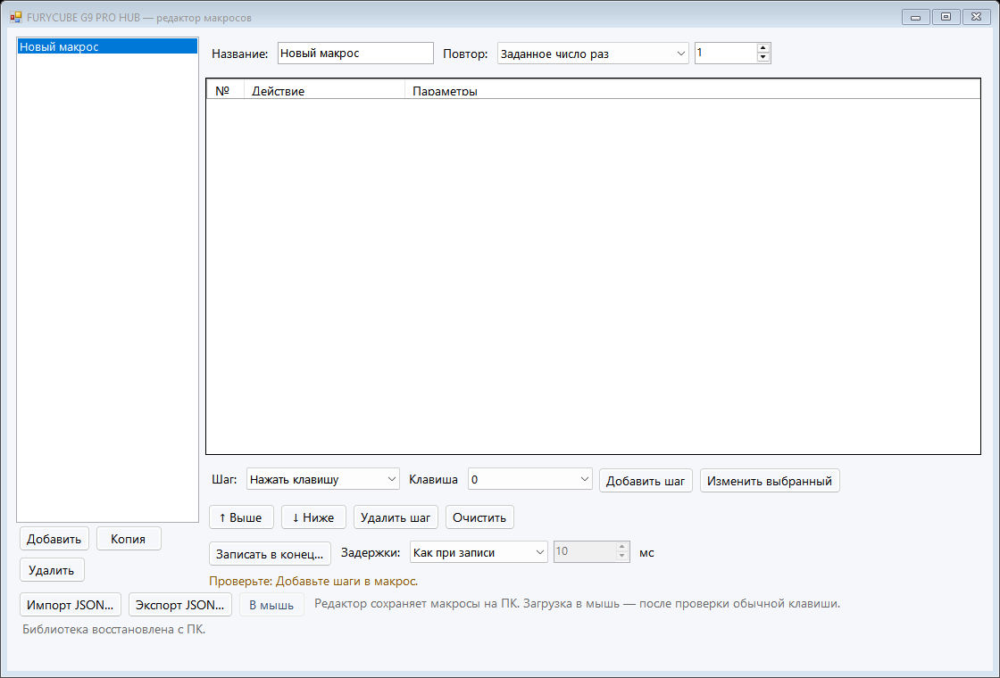

# FURYCUBE G9 PRO HUB

An independent Windows application for the **FURYCUBE G9 PRO** mouse: onboard
button assignments, DPI, sensor and power settings, portable profiles, a local
macro editor, and an OLED layout editor with images and useful widgets.
Written in C# using Windows HID and the built-in .NET Framework.

**Experimental, unofficial project.** The desktop editor and configuration
client work; the firmware changes have passed offline checks but have **not
been installed or validated on the development mouse**. The application does
not flash firmware automatically.

Firmware preparation now recalculates the image header's body CRC32 and word
length, in addition to each changed block's CRC16. Older candidates with an
unchanged header are superseded; see [header validation](docs/FIRMWARE-HEADER.md).

The development mouse's replacement board photos now identify **BK3633QN48**,
**EPC-V18U0002**, printed **2025-4-3**, with a **PAW3311DB-T2MU** sensor. Earlier
reference pictures were another mouse and are excluded. This identifies the
visible hardware; full flash readback, board programming connections, installed
boot/security state and recovery are still unproven. Other revisions are not
qualified by a shared product name. See [hardware evidence](docs/HARDWARE-IDENTITY.md).

## Get started

Windows 10/11 x64 with .NET Framework 4.x. No Visual Studio, Python, vendor HUB,
or additional input driver is required for the normal application build.

```powershell
git clone https://github.com/fxpw/FURYCUBE-G9-PRO-HUB.git
cd FURYCUBE-G9-PRO-HUB
.\build.cmd
.\Run-Hub.cmd
```

The build creates `bin/FURYCUBE-G9-PRO-HUB.exe` and `bin/G9Device.exe`, then runs
offline checks. GitHub Actions also builds the application on Windows.
The current interface is in Russian; this README is in English.

The manufacturer's software is optional:
[official G9 PRO downloads](https://www.furycube.com/pages/g9-pro).
Close the old HUB before changing settings: it can overwrite the mouse with
its own saved profile.

## Button assignments

The **Мышь → Назначения кнопок** (Mouse → Button assignments) page contains the original
HUB's assignment categories: mouse clicks and scrolling, DPI, keyboard keys
and modifiers, onboard macro slots, media controls, browser actions,
application shortcuts, and profile actions.

1. Click **Прочитать из мыши** to read the current button table.
2. Select a physical button or wheel direction.
3. Choose a category, action, and any parameters.
4. Click **Записать в мышь** to save and read the result back.

Only the selected assignment changes. Each write creates a button-table backup
under `%LOCALAPPDATA%\FURYCUBE-G9-PRO\backups`. At least one main physical button
must retain left click. Reading selects the currently active onboard profile
(1–5); an edit refuses a changed profile instead of silently switching it.
Reserved slots are
hidden by default because their physical meaning is unconfirmed.

Assignments reside in the mouse and do not require the HUB to stay open.
Selecting a macro assigns an **existing onboard slot**. The new macro editor
authors sequences locally; device upload remains unfinished. A candidate firmware fix
removes the OLED button's hold-gesture delay; physical validation is still pending.

## DPI, sensor, power, and profiles

Open **Мышь → DPI, сенсор и питание**, then click **Прочитать из мыши**.
The application reads the connected mouse; it does not apply a saved profile
at startup or replace failed reads with defaults. This settings path currently
requires the **USB cable**; receiver long-report framing is not qualified.



- DPI values and RGB metadata, enabled-stage checkboxes, and the active stage.
  The stock UI range is 50–22000, in steps of 50 through 10000 and 100 above it.
  This is a configured value, not a physical sensor calibration claim. Slots
  7/8 are marked reserved; the old G9 page exposes six stages.
- Polling rate: 125/250/500/1000 Hz. Unsupported higher rates are not offered.
- Click debounce: 4–50 ms in steps of 2; Ripple Control and Angle Snap choices.
- Level-1 sleep: 0.5–30 minutes in half-minute steps. Standby: 1–60 minutes.
  The two timers follow the native UI's actual conversion, not ambiguous resource
  names or an unused translation string.
- Explicit active-profile and profile-count controls, keeping the other setting.
  Release mouse buttons before switching a profile. Apply profile switching
  separately from other edits, then reread button assignments.
- Named local profiles: save, open as drafts, rename, archive, import, and export.
  They include supported parameters and the captured button table; macro sequences
  remain a separate library. Older settings-only files are still accepted.

Sliders, numeric fields, dropdowns, checkboxes, and colour pickers edit drafts.
**Применить изменения** writes only the changes, with a fresh read, durable backup,
profile checks and independent readback. A multi-field save is sequential: an error
stops later writes and invalidates the displayed snapshot; earlier changes may
already be saved. Nothing is retried or reset automatically. A stock USB reply can
occasionally contain a previous payload; checksum and consistency checks reject
it. Reconnect before retrying an interrupted transaction.

Backups under `%LOCALAPPDATA%\FURYCUBE-G9-PRO\backups` contain the logical 117-byte
profile and individual raw replies, including the complete button checksum.
These are **configuration backups**, excluding the firmware and macro bank.
The local library lives in `profiles`; deleting a preset archives its file in
`profiles\.deleted`. Import first shows drafts and a checkbox for transferring
button assignments; it never writes immediately.

If a selected profile's full body cannot be read, **Устройство и прошивка →
Восстановить выбор профиля…** can restore just the saved active/count pair from
a same-device settings snapshot. It backs up the current pair, sends one guarded
profile command, and verifies the pair; it does not rewrite profile contents.
This recovery command has passed synthetic-transport checks, not a physical
profile-switch test. See [pair-only restore](docs/PROFILE-PAIR-RESTORE.md).

LOD, Motion Sync, body lighting and RF power are listed as unavailable with a
reason. Shared OEM resources do not prove G9 support. RF read/write ranges differ,
so an incomplete RF baseline is never used for a write. See the
[parity inventory](docs/SETTINGS-PARITY.md) and [read handshake](docs/READ-HANDSHAKE.md).

Physical checks: complete wired settings read succeeded. A standby-timer write
was observed and then restored to its original value with complete readback;
the logical profile, buttons and profile record matched their initial bytes.
Other setting types have passed offline packet/preservation checks and still
need individual hardware validation.

## Local macro editor

**Мышь → Макросы** provides named macros, key/button press and release steps,
movement, wheel, delays, repeat metadata, reordering, JSON import/export and
autosave. Recording captures only the explicitly focused recorder window;
it does not install a global input hook or play back input.



The **В мышь** button is disabled. The project currently authors portable macros,
not verified onboard packets; physical upload/testing follows ordinary keyboard
output validation. See [macro format and recorder](docs/MACROS.md).

## OLED editor


The **Экран и виджеты** tab provides:

- PNG/JPEG/BMP/GIF/TIFF import, fit/crop/stretch, threshold, dithering, and invert.
- Text, clock, mouse battery/DPI level, CPU/GPU load, RAM, and temperature widgets.
- Independent X/Y, width, height, and font-size sliders; drag layers in the preview.
- Image positioning and resizing, including clipping outside the canvas.
- Presets, labels, checkboxes, portable JSON projects with image assets, autosave,
  and PNG/packed-frame export.

The canvas is **120 × 28 monochrome pixels**. CPU and RAM use Windows APIs.
NVIDIA metrics use NVML from an existing driver installation. CPU temperature
can use an already running local sensor source; no sensor driver is installed.
Battery and DPI-level widgets listen to passive mouse input reports. Missing or
expired values show a dash. `DPI#` is the last reported level number (1–8),
**not** numeric DPI. The separate numeric widget uses an OL3 snapshot of the
configured value used by the stock OLED, with a maximum host age of one second.
OL3 has passed offline checks; it has not been installed or tested on the mouse.
Stock and OL2 leave the numeric widget unavailable.
Profile notifications invalidate the cached level; lost notifications prevent
using a stored table as a reliable live numeric-DPI source. The saved DPI frame
format is decoded separately and is never presented as a fresh device readback.
After disconnecting the telemetry source, restart the HUB to connect it again.
GIF import currently uses one frame.

**Physical OLED upload requires the experimental OL2 or OL3 firmware extension.**
Stock firmware does not advertise it. The host checks capabilities before writing
a frame. Physical orientation and retention remain unverified. Stock redraws
can overwrite a custom image, and stock sleep/off code explicitly clears it.
Persistent image storage and exclusive display ownership are not implemented.
Live PC widgets require the HUB to keep
running and sending updates. Enable **Обновлять OLED каждую секунду** for live
updates; the helper reuses one verified connection and initializes only the first
frame. An error stops updates without automatic retries. Live updates are off
after every application launch. A desktop preview does not prove OLED support.

OL3 status is requested only for an explicit upload/live update that renders a
numeric DPI widget. It does not combine passive profile events with saved tables.
Invalid/busy/expired replies show a dash; an OL2 session can still send pixels.
The normal A0 request wakes the mouse/display and updates inactivity timers.
The custom status path skips profile preload/reload and does not write NVM.

## Development and verification

`build.cmd` runs packet, assignment, rendering, project-portability, sensor,
OLED-protocol, and firmware-builder checks. Tests use captured fixtures and fake
transports; these are kept separate from real-device results. Firmware integration
checks requiring a proprietary local input are explicitly skipped when that
input is absent, including in public CI.

| Source | Purpose |
|---|---|
| `src/G9Hub.cs` | Application window and local firmware preparation |
| `src/G9ButtonEditor.cs`, `src/G9Bindings.cs` | Assignment UI and original-HUB action catalog |
| `src/G9Device.cs` | Independent HID client, validation, backups, and readback |
| `src/G9MouseSettings.cs`, `src/G9SettingsTransactions.cs` | Exact settings codecs and guarded read/write transactions |
| `src/G9MouseSettingsEditor.cs`, `src/G9ProfileLibrary.cs` | Settings UI, portable profiles and import previews |
| `src/G9Macro.cs`, `src/G9MacroEditor.cs` | Local macro authoring, focused recording and portable JSON |
| `src/G9ReadHandshake.cs` | Bounded ACK-only readiness wait without resending a request |
| `src/G9Screen.cs`, `src/G9ScreenEditor.cs` | Rendering, image layers, widgets, and projects |
| `src/G9Sensors.cs` | Optional system metrics without installing drivers |
| `src/G9Telemetry.cs`, `src/G9TelemetryReader.cs` | Passive mouse battery and DPI-level input |
| `src/G9Oled.cs`, `src/G9OledRuntimeStatus.cs` | OL2/OL3 capabilities, frames and fresh numeric status |
| `src/G9FirmwareOledPatch.cs`, `firmware/g9_oled.S` | Offline firmware builder and own ARM extension |
| `src/G9FirmwareOl3Patch.cs`, `firmware/g9_ol3.S` | Offline OL3 candidate, preserving the original OL2 code |

Useful configuration commands:

```powershell
.\bin\G9Device.exe caps
.\bin\G9Device.exe mapping
.\bin\G9Device.exe firmware
.\bin\G9Device.exe backup
.\bin\G9Device.exe settings-read --pid 2148
```

The wired device (`VID 1D57 / PID 2148`) is preferred when connected.
Use `--pid fa60` to select the 2.4 GHz receiver for supported configuration
commands. OLED transfer is wired-only. These commands do not install firmware.

Current milestones: [PLAN.md](PLAN.md).
Firmware preparation and recovery status: [docs/FIRMWARE.md](docs/FIRMWARE.md).
Recovery requirements before any installation: [docs/RECOVERY.md](docs/RECOVERY.md).
The [minimal-sector calculation](docs/MINIMAL-UPDATE-PLAN.md) reduces a proposed
future update's scope; it is not an installer or a verified recovery method.
Current readback research and the offline-only archive verifier:
[docs/RECOVERY-NEXT-STEPS.md](docs/RECOVERY-NEXT-STEPS.md). It validates supplied
captured pages; it cannot read the mouse or clear the firmware recovery gate.
The separate [keyboard-release prototype](docs/KEYBOARD-RELEASE-PROTOTYPE.md)
has offline coverage for configuration changes; it is not an installable image.
Detailed research: [hardware identity](docs/HARDWARE-IDENTITY.md),
[normal USB readback](docs/USB-READBACK.md), [UART/security](docs/RECOVERY-UART.md).
Mouse telemetry sources: [docs/TELEMETRY.md](docs/TELEMETRY.md).
[Numeric DPI format and live-source requirements](docs/DPI-SETTINGS.md).
[OL3 protocol and offline proof](docs/OL3-STATUS-DESIGN.md),
[stock redraw and frame lifetime](docs/OLED-REDRAW.md).
OLED wire format and ARM extension: [firmware/OLED-PROTOCOL.md](firmware/OLED-PROTOCOL.md).
Research emulators require Python, Capstone, Unicorn, and a separately obtained
official firmware image; they are not required to run the HUB.

## License and attribution

Own source code is licensed under [MIT](LICENSE). FURYCUBE trademarks, vendor
executables, and complete vendor firmware images belong to their respective
owners and are not distributed in this repository.

Research used static analysis, Capstone, Unicorn, and
[REA](https://github.com/morluto/rea). This project is not an official FURYCUBE update.
