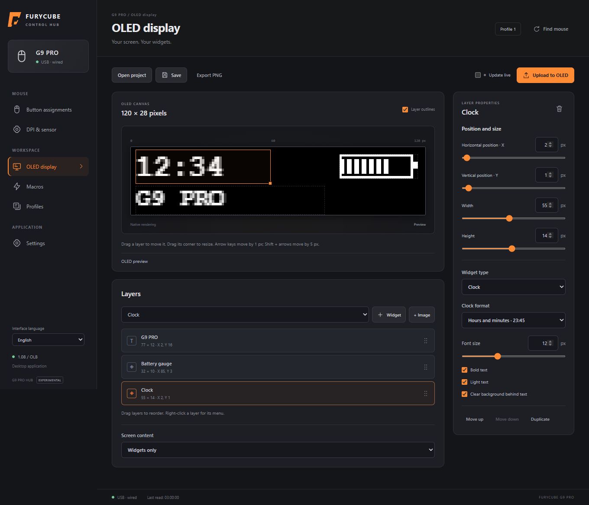

# FURYCUBE G9 PRO HUB

An independent Windows control app for the **FURYCUBE G9 PRO** mouse, with a
Vue 3 + TypeScript interface and a C# Windows HID backend. Configure buttons,
DPI and power settings, design OLED layouts, and manage local profiles and macros.
The interface supports **Russian and English**.


*All screenshots show the current English Vue interface with sample data.
They illustrate the UI, not hardware validation or a live device connection.*

## Current support

This is an **unofficial, experimental project**. Hardware checks apply to one
identified development mouse, not every device sold under the same name.

| Feature | Current status |
| --- | --- |
| Onboard button assignments | The ordinary-key fix was confirmed over USB and 2.4 GHz with the HUB closed. Assignments use guarded writes and readback. |
| DPI, sensor and power settings | Complete wired reads and a timer write/restore were physically checked. Other setters have offline coverage. |
| Settings over 2.4 GHz | Sensor/DPI, polling, buttons and profile reads match the USB baseline. Polling-setting writes passed CLI and Vue checks, with restoration to the original value. Other setters need individual checks; power timers/debounce still need USB. See [radio settings](docs/RADIO-SETTINGS.md). |
| Custom OLED on OL4 | USB frames, numeric DPI and live clock/system widgets were confirmed while ordinary mouse input continued working. |
| OL5 OLED and retained last frame | Installed on the development mouse; USB image and continued input were confirmed. The radio image did not appear and later configuration reads timed out, so receiver OLED is disabled in the native client and UI. Unplugging only USB with the switch already at 2.4 GHz loses the image. |
| OL6 carrier experiment | Earlier installation introduced a separate experimental client. The owner confirmed radio input but reported missing USB mouse input. It was superseded by OL7 before any image upload. |
| OL7 USB input guard | Currently installed. The owner confirms USB input after Windows restart; settings match the saved profile. The next radio attempt timed out on ordinary GET0C before sending an image; receiver restart returned3010. |
| OL8 / OL9 candidates | Separate context-kind and checksum hypotheses have passed complete offline checks and exact updater packaging. Neither is installed. See the [candidate matrix](docs/RF-CANDIDATE-MATRIX.md). |
| PC-side last-frame resume | Successful submissions are cached atomically with a checksum. Static frames restore without enabling live updates; live mode resumes rendering. Reconnect/restart/error cases are tested with fake transports; physical replay remains pending. |
| Macro editor | Local authoring, recording and JSON import/export. Uploading new macros to the mouse is unfinished. |
| Firmware recovery | Configuration backups exist; a complete installed-firmware dump and independent rollback remain unverified. |

An earlier OLED session lost mouse input and required a Windows reboot. The
708-byte OL4 extension included an endpoint-readiness guard and passed
bounded post-reboot checks; the complete cause of the earlier persistent failure
has not been isolated. The later OL5 experiment preserves that guard and passed
an ordinary-input and single-USB-frame check. The HUB does not install firmware
automatically.

The next hardware milestone is an ordinary working radio configuration read,
then a visible control image. The PC-side frame cache and reconnect path are
implemented, while ordinary receiver OLED remains disabled pending end-to-end
qualification. No OL6/OL7 image has been sent. The brief screen change reported
at startup has not been identified as host traffic or a firmware redraw.
See [OLED development checkpoints](docs/OLED-RETENTION-DESIGN.md).

## Build and run

Requirements: Windows 10/11 x64, .NET Framework 4.x, Microsoft Edge WebView2
Runtime, **Node.js 22** and npm. Node.js is needed to build the frontend; the
compiled app runs without a development server. Visual Studio, Python and the
vendor HUB are not required for this build.

```powershell
git clone https://github.com/fxpw/FURYCUBE-G9-PRO-HUB.git
cd FURYCUBE-G9-PRO-HUB
.\tools\build-vue-hub.cmd
.\Run-Hub.cmd
```

The first build downloads pinned npm dependencies and the WebView2 SDK. Output:
`bin/FURYCUBE-G9-PRO-HUB.exe`, `bin/G9Device.exe`, the WebView2 loader assemblies,
and `frontend/dist`. Keep these together in the project directory.

The manufacturer's software is optional:
[official G9 PRO downloads](https://www.furycube.com/pages/g9-pro).
Close the old HUB before changing settings: it can overwrite the mouse using its
own saved profile. No additional input driver is installed by this project.

## Button assignments

Open **Button assignments**, use **Find mouse** if a fresh read is needed, and
select a button on the diagram or in the list. Choose an action, keyboard key,
modifiers or an existing onboard macro slot, then click **Apply**.

The catalog includes mouse clicks and scrolling, DPI actions, keyboard shortcuts,
media controls, browser actions, application shortcuts and profile actions. The
sixth button is the small OLED screen on the mouse.

Only the chosen assignment changes. Writes preserve the other entries, check the
active profile, create a backup and read the result back. At least one main
physical button must retain left click. Stored assignments work without the HUB;
PC-driven widgets require it to remain running.

## DPI, sensor and power


The **DPI & sensor** page groups controls into **DPI stages**, **Sensor & response**,
**Power**, and **Profile & more**. It provides sliders, numeric inputs, colour
pickers, dropdowns and enabled-stage switches.

- Configured DPI values and RGB metadata, enabled stages and the selected stage.
  The stock UI range is 50–22000, in steps of 50 through 10000 and 100 above it.
  These are configured values, not a physical sensor-calibration claim.
- Polling rate: 125/250/500/1000 Hz; button debounce: 4–50 ms in steps of 2.
- Ripple Control, Angle Snap, first-stage sleep and idle timeout.
- Active-profile and profile-count controls. Apply profile switching separately
  from other changes, then reread the device.

**Read** refreshes the device snapshot. Editing changes drafts; **Apply** checks
all values and intermediate DPI states before writing. A multi-field save is
sequential: a failure stops later writes, while earlier changes may already have
been saved. Invalid or stale replies are rejected instead of becoming defaults.

The complete-settings path requires USB. Radio reads expose supported DPI,
sensor, polling, button and profile records; power timers and debounce still need
USB. LOD, Motion Sync, body lighting and RF
power show their availability limits rather than offering unverified controls.
See the [settings inventory](docs/SETTINGS-PARITY.md) and
[readback protocol](docs/READ-HANDSHAKE.md).

## OLED layouts



The **OLED display** editor works on a **120 × 28 monochrome canvas**:

- Import PNG/JPEG/BMP/GIF/TIFF; fit, crop or stretch; adjust threshold, dithering
  and inversion. GIF import uses one frame.
- Add text, clocks, battery, numeric DPI or DPI-stage widgets, CPU/GPU usage,
  RAM usage and available temperature readings.
- Drag a layer or its resize handle. X/Y, width, height and font size can also be
  changed independently with sliders and numeric fields.
- Open/save portable JSON layouts with image assets, export PNG previews, and
  restore the last editor autosave.

Use **+ Image** or **+ Widget**, adjust the layout, then choose **Upload to OLED**.
**Update live** sends ongoing clock and metric updates. CPU/RAM use Windows APIs;
optional GPU/temperature sources use existing local drivers or sensor services.
Unavailable or expired values show a dash. `DPI#` is a stage number; the numeric
DPI widget uses a separate validated device-status snapshot.

Portable examples:

| Layout | Contents |
| --- | --- |
| [Clock and system](examples/screens/clock-system.g9screen.json) | Clock, battery, CPU and RAM |
| [Clock, DPI and system](examples/screens/clock-dpi-system.g9screen.json) | Clock, numeric DPI, CPU and RAM |
| [Positioned image](examples/screens/positioned-image.g9screen.json) | An 84 × 20 image at X=18, Y=4, with its bundled asset |

**Physically verified OLED upload currently covers OL4 and OL5 over USB.** Stock
firmware does not advertise the extension; native OL2/OL3 image writes are blocked
because their long-packet assembly failure was reproduced. Receiver OLED upload/live is currently
disabled after a failed delivery test; image submission to Windows alone did
not establish forwarding by the receiver. Connect the mouse by USB for OLED.

On current OL4, native redraws, sleep and connection changes can replace or clear
a custom image. Keeping the last frame across modes or power loss is not yet
supported. Live widgets require the HUB and the supported connection. Errors stop
updates without blind retries. See [OL4 transport](docs/OLED-USB-CHUNKS.md),
[stock redraw behaviour](docs/OLED-REDRAW.md) and the
[experimental retention design](docs/OLED-RETENTION-DESIGN.md).

## Local macros


Create named sequences of key/button presses and releases, movement, wheel events
and delays. Reorder steps, set repeat metadata, record in the focused recorder,
and import/export JSON. The editor saves its library on the computer.

**Uploading newly authored macros to the mouse is not available yet.** Button
assignments can select an already populated onboard slot. No global input hook
or background input playback is installed. See [macro format](docs/MACROS.md).

## Profiles, language and background mode

**Profiles** saves named settings drafts with an optional button table. Opening or
importing a profile does not write the mouse. Transferring its button assignments
requires an explicit choice; deleting a local profile archives its file.

**Settings → Interface language**, or the selector in the sidebar, switches
between Russian and English. The choice persists. User profile/macro names and
OLED text stay unchanged; raw device and Windows diagnostics retain their source
language.

Settings also contains **Start HUB with Windows** and **Resume OLED updates at
startup**. Both require an explicit choice. Resume starts only after the device
has been checked; it does not apply a saved mouse profile. A saved static frame
restores as static, while saved live mode resumes rendering. A cache from an
earlier process does not start traffic until startup resume is enabled. Closing or minimizing
the window hides it in the tray; use **Quit HUB** or the tray's **Exit** to stop it.

Local data is stored under `%LOCALAPPDATA%\FURYCUBE-G9-PRO`:

| Folder/file | Contents |
| --- | --- |
| `backups` | Logical settings snapshots, button tables and raw configuration replies |
| `profiles` | Portable settings presets; deleted files go to `.deleted` |
| `editor` | OLED autosave, image assets and local macro library |
| `editor/*.last-frame` | Last successful host-submitted frame and static/live mode, with atomic replacement and checksum |
| `hub-background.json` | Background-resume preference |

Configuration snapshots are **not firmware backups** and do not contain the
complete macro bank. Firmware updates can reset settings; see
[restoration limits](docs/RECOVERY.md).

## Development and verification

```powershell
# Native offline checks; also builds the earlier WinForms interface.
.\build.cmd
python -m unittest discover -s tests -p "test_*.py"

# Vue checks and browser tests using installed Microsoft Edge.
npm --prefix frontend ci
npm --prefix frontend run typecheck
npm --prefix frontend test

# Build the Vue desktop app after native checks.
.\tools\build-vue-hub.cmd
```

The recorded local checkpoint passed **11,403 C# checks**, **41 Python tests** and
**13 Vue/Edge UI tests**. Browser tests use synthetic bridge data and never open
the mouse. Native fixtures, firmware emulation and physical checks are distinct;
proprietary-input tests are explicitly skipped when that input is absent.
The current GitHub Actions workflow checks/packages the native application;
Vue desktop packaging is a separate build step.

| Area | Main sources |
| --- | --- |
| Vue interface and translations | `frontend/src/components`, `frontend/src/i18n.ts` |
| WebView2 host and bridge | `src/G9VueShell.cs`, `src/G9VueEditors.cs`, `src/G9WebApi.cs` |
| Discovery, startup and lifecycle | `src/G9Hub.cs`, `src/G9Startup.cs` |
| Guarded HID operations | `src/G9Device.cs`, `src/G9ReadHandshake.cs`, `src/G9SettingsTransactions.cs` |
| Settings, assignments and profiles | `src/G9MouseSettings.cs`, `src/G9Bindings.cs`, `src/G9ProfileLibrary.cs` |
| Rendering and sensors | `src/G9Screen.cs`, `src/G9Sensors.cs`, `src/G9TelemetryReader.cs` |
| OL4 implementation | `src/G9FirmwareOl4Patch.cs`, `firmware/g9_ol4.S` |
| Offline OL5 radio/retention work | `firmware/g9_ol5.S`, `tools/emulate_ol5_radio.py`, `tools/emulate_ol5_retention.py` |

Frontend setup and editing: [frontend/README.md](frontend/README.md).
Milestones and remaining work: [PLAN.md](PLAN.md).
Firmware and compatibility: [docs/FIRMWARE.md](docs/FIRMWARE.md).
Recovery evidence: [docs/RECOVERY.md](docs/RECOVERY.md).
Hardware identity: [docs/HARDWARE-IDENTITY.md](docs/HARDWARE-IDENTITY.md).

The development unit is BK3633QN48 / EPC-V18U0002, dated 2025-4-3, with a
PAW3311DB-T2MU sensor. Other revisions are not qualified by a shared product name.
Firmware research tools need Python, Capstone, Unicorn and a separately obtained
official image; those are not required to run the HUB. Offline OL5 still needs an
explicit review of its larger transfer before any installation experiment.

## License and attribution

Own source is [MIT licensed](LICENSE). FURYCUBE trademarks, vendor executables and
complete vendor firmware images belong to their respective owners and are not
distributed here. Research used static analysis, Capstone, Unicorn and
[REA](https://github.com/morluto/rea). This is not an official FURYCUBE update.
