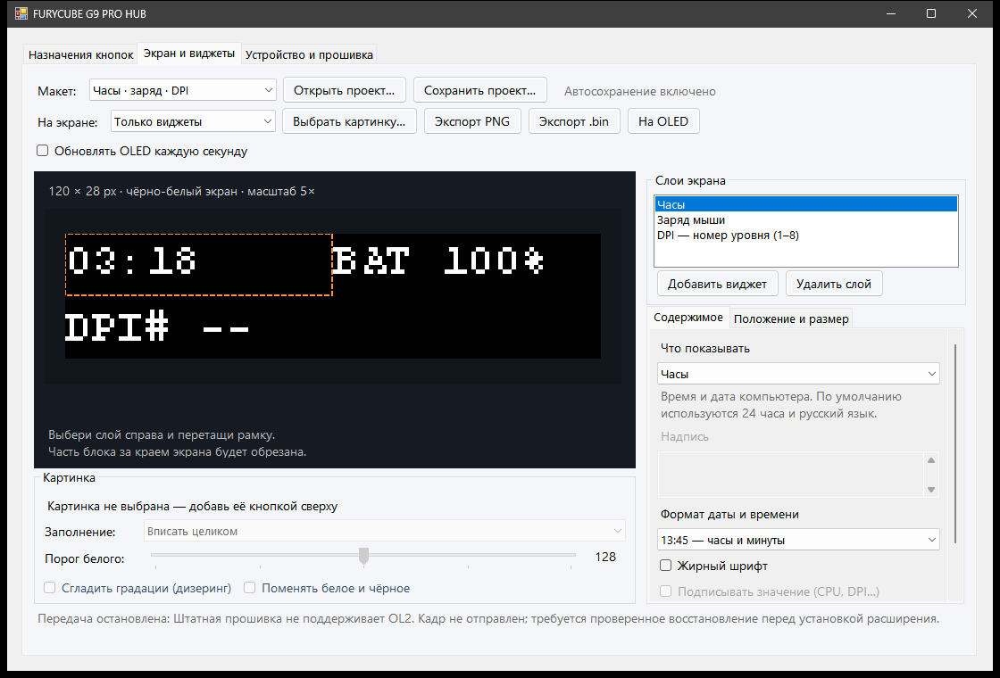

# FURYCUBE G9 PRO HUB

An independent Windows application for the **FURYCUBE G9 PRO** mouse: onboard
button assignments, an OLED layout editor, images, and useful widgets.
Written in C# using Windows HID and the built-in .NET Framework.

**Experimental, unofficial project.** The desktop editor and configuration
client work; the firmware changes have passed offline checks but have **not
been installed or validated on the development mouse**. The application does
not flash firmware automatically.

## Get started

Windows 10/11 x64 with .NET Framework 4.x. No Visual Studio, Python, vendor HUB,
or additional input driver is required for the normal application build.

```powershell
git clone https://github.com/fxpw/FURYCUBE-G9-PRO-HUB.git
cd FURYCUBE-G9-PRO-HUB
.\build.cmd
.\Run-Hub.cmd
```

The build creates `bin/FURYCUBE-G9-PRO-HUB.exe` and `bin/G9Device.exe`, then runs
offline checks. GitHub Actions also builds the application on Windows.
The current interface is in Russian; this README is in English.

The manufacturer's software is optional:
[official G9 PRO downloads](https://www.furycube.com/pages/g9-pro).
Close the old HUB before changing settings: it can overwrite the mouse with
its own saved profile.

## Button assignments

The first tab, **Назначения кнопок** (Button assignments), contains the original
HUB's assignment categories: mouse clicks and scrolling, DPI, keyboard keys
and modifiers, onboard macro slots, media controls, browser actions,
application shortcuts, and profile actions.

1. Click **Прочитать из мыши** to read the current button table.
2. Select a physical button or wheel direction.
3. Choose a category, action, and any parameters.
4. Click **Записать в мышь** to save and read the result back.

Only the selected assignment changes. Each write creates a button-table backup
under `%LOCALAPPDATA%\FURYCUBE-G9-PRO\backups`. At least one main physical button
must retain left click. The current client edits profile 1. Reserved slots are
hidden by default because their physical meaning is unconfirmed.

Assignments reside in the mouse and do not require the HUB to stay open.
Selecting a macro assigns an **existing onboard slot**; creating and uploading
macro sequences is a separate, unfinished feature. A candidate firmware fix
removes the OLED button's hold-gesture delay; physical validation is still pending.

## OLED editor



The **Экран и виджеты** tab provides:

- PNG/JPEG/BMP/GIF/TIFF import, fit/crop/stretch, threshold, dithering, and invert.
- Text, clock, mouse battery/DPI level, CPU/GPU load, RAM, and temperature widgets.
- Independent X/Y, width, height, and font-size sliders; drag layers in the preview.
- Image positioning and resizing, including clipping outside the canvas.
- Presets, labels, checkboxes, portable JSON projects with image assets, autosave,
  and PNG/packed-frame export.

The canvas is **120 × 28 monochrome pixels**. CPU and RAM use Windows APIs.
NVIDIA metrics use NVML from an existing driver installation. CPU temperature
can use an already running local sensor source; no sensor driver is installed.
Battery and DPI-level widgets listen to passive mouse input reports. Missing or
expired values show a dash. `DPI#` is the level number (1–8), **not** numeric DPI;
the separate numeric-DPI widget remains unavailable until its source is verified.
After disconnecting the telemetry source, restart the HUB to connect it again.
GIF import currently uses one frame.

**Physical OLED upload requires the experimental OL2 firmware extension.**
Stock firmware does not advertise it. The host checks capabilities before writing
a frame. Physical orientation, sleep, and persistence remain unverified; the stock
renderer may overwrite a custom image. Live PC widgets require the HUB to keep
running and sending updates. Enable **Обновлять OLED каждую секунду** for live
updates; the helper reuses one verified connection and initializes only the first
frame. An error stops updates without automatic retries. Live updates are off
after every application launch. A desktop preview does not prove OLED support.

## Development and verification

`build.cmd` runs packet, assignment, rendering, project-portability, sensor,
OLED-protocol, and firmware-builder checks. Tests use captured fixtures and fake
transports; these are kept separate from real-device results. Firmware integration
checks requiring a proprietary local input are explicitly skipped when that
input is absent, including in public CI.

| Source | Purpose |
|---|---|
| `src/G9Hub.cs` | Application window and local firmware preparation |
| `src/G9ButtonEditor.cs`, `src/G9Bindings.cs` | Assignment UI and original-HUB action catalog |
| `src/G9Device.cs` | Independent HID client, validation, backups, and readback |
| `src/G9Screen.cs`, `src/G9ScreenEditor.cs` | Rendering, image layers, widgets, and projects |
| `src/G9Sensors.cs` | Optional system metrics without installing drivers |
| `src/G9Telemetry.cs`, `src/G9TelemetryReader.cs` | Passive mouse battery and DPI-level input |
| `src/G9Oled.cs` | OL2 capability checks and frame encoding |
| `src/G9FirmwareOledPatch.cs`, `firmware/g9_oled.S` | Offline firmware builder and own ARM extension |

Useful configuration commands:

```powershell
.\bin\G9Device.exe caps
.\bin\G9Device.exe mapping
.\bin\G9Device.exe firmware
.\bin\G9Device.exe backup
```

The wired device (`VID 1D57 / PID 2148`) is preferred when connected.
Use `--pid fa60` to select the 2.4 GHz receiver for supported configuration
commands. OLED transfer is wired-only. These commands do not install firmware.

Current milestones: [PLAN.md](PLAN.md).
Firmware preparation and recovery status: [docs/FIRMWARE.md](docs/FIRMWARE.md).
Recovery requirements before any installation: [docs/RECOVERY.md](docs/RECOVERY.md).
Mouse telemetry sources: [docs/TELEMETRY.md](docs/TELEMETRY.md).
OLED wire format and ARM extension: [firmware/OLED-PROTOCOL.md](firmware/OLED-PROTOCOL.md).
Research emulators require Python, Capstone, Unicorn, and a separately obtained
official firmware image; they are not required to run the HUB.

## License and attribution

Own source code is licensed under [MIT](LICENSE). FURYCUBE trademarks, vendor
executables, and complete vendor firmware images belong to their respective
owners and are not distributed in this repository.

Research used static analysis, Capstone, Unicorn, and
[REA](https://github.com/morluto/rea). This project is not an official FURYCUBE update.
