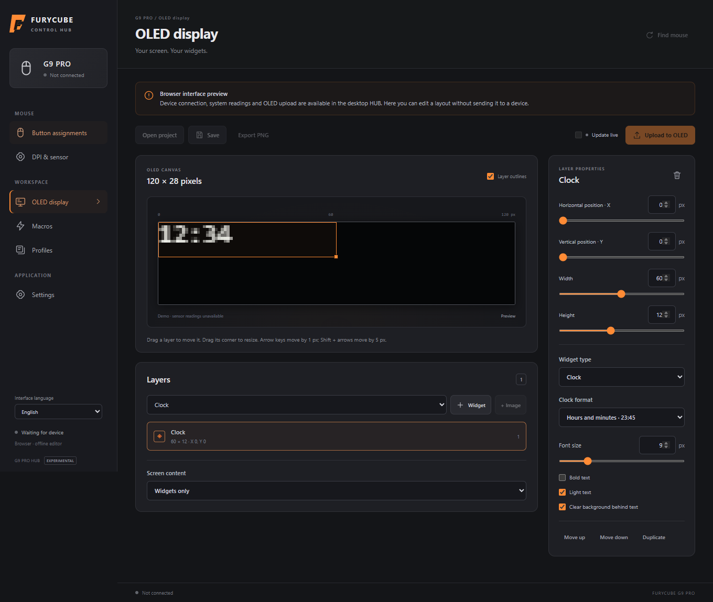
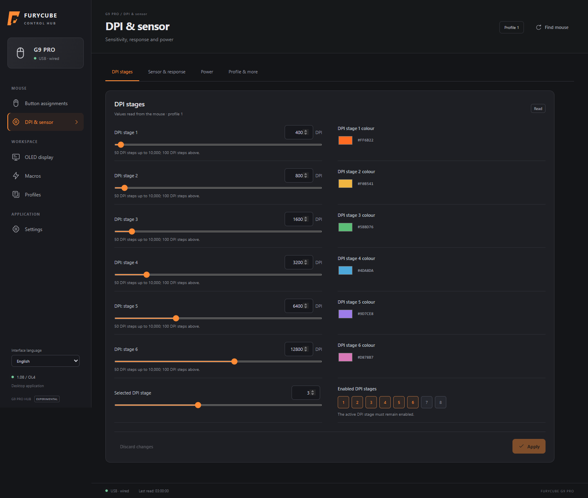
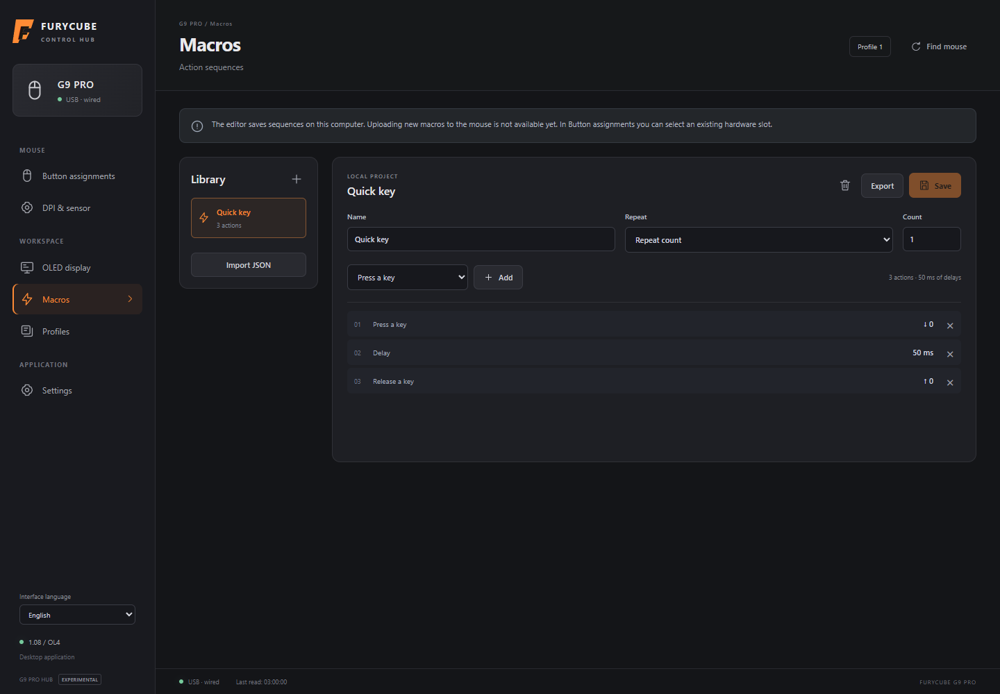

# FURYCUBE G9 PRO HUB

An independent Windows control app for the **FURYCUBE G9 PRO** mouse, with a
Vue 3 + TypeScript interface and a C# Windows HID backend. Configure buttons,
DPI and power settings, design OLED layouts, and manage local profiles and macros.
The interface supports **Russian and English**.



*Screenshots show the English Vue interface with sample data.*

## Current support

This is an **unofficial, experimental project**. Hardware results apply to the
[tested G9 PRO hardware revision](docs/HARDWARE-IDENTITY.md).

| Feature | Current status |
| --- | --- |
| Onboard button assignments | Assignments use guarded writes and readback. A keyboard assignment on the OLED button was confirmed over USB and 2.4 GHz with the HUB closed. |
| DPI, sensor and power settings | Complete wired reads and a power timer write and restore were verified on hardware. |
| Settings over 2.4 GHz | The HUB reads the profile, DPI, sensor, polling and button settings. Polling writes and restoration were verified on hardware. Power timers and debounce require USB. See [radio settings](docs/RADIO-SETTINGS.md). |
| Custom OLED over USB | Images, numeric DPI and live clock and system widgets were verified on compatible firmware. |
| Custom OLED over 2.4 GHz | Full-frame delivery was verified on OL9 with active profile 1. See the [firmware candidate matrix](docs/RF-CANDIDATE-MATRIX.md). |
| PC-side last-frame resume | The HUB caches the last submitted frame with a checksum. A static frame was restored after switching the mouse off and back to 2.4 GHz with the same receiver. |
| Macro editor | Local authoring, recording and JSON import/export. Uploading new macros to the mouse is unfinished. |
| Firmware recovery | The HUB saves configuration backups. A complete firmware dump and independent recovery path remain unverified. |

### OLE development checkpoint

A local development build uses OLE firmware to confirm 2.4 GHz OLED frames
after the mouse draws them. Small updates advance from the last confirmed
frame. If a confirmation is missed, the HUB can retry the same update
before falling back to a full frame. A full refresh waits for idle input,
so the first frame can take longer than later updates. See the
[radio OLED protocol and earlier experiments](docs/OL9-CARRIER.md).

The local build pauses background OLED writes while a mouse button is held
and resumes after release. In a 9.8-second left-button hold, Windows recorded
one press and one release, with no OLED packets sent during the hold.
The next frame was confirmed about 0.7 seconds after release.

Launching the registered Windows startup command in the current session
started the local build in the tray, read the active profile over 2.4 GHz
and restored the saved static frame with confirmation from the mouse.
An actual Windows sign-in remains to be checked. The repository includes
the OLE source and offline validation tools. The locally built updater
and embedded layout are kept with the private hardware test materials.

## Quick input check

Run `bin\G9InputCheck.exe --pid fa60` for the receiver, or use `--pid 2148`
for USB. The standalone check is built by `build.cmd` or
`tools\build-input-check.cmd` and is included in the Windows CI package.
Add `--lang en` for English; Russian is the default.

The nine rows turn green for movement, five mouse buttons, wheel up/down and
the OLED button. The input check expects that button to be assigned to **0**.
Mouse buttons require both press and release. The tool uses Windows Raw Input
and counts events from the selected G9 transport.

After all nine rows pass, the window closes automatically after two seconds.
Closing early or reaching the ten-minute limit saves an incomplete result with
the missing items. Timestamped JSON reports and event logs are saved under
`%LOCALAPPDATA%\FURYCUBE-G9-PRO\input-checks`; use `--output <new-report.json>`
to choose a new location. Input checks passed 9/9 over USB on the OLE
development mouse. Earlier USB and receiver checks are recorded in the
[hardware test plan](PLAN.md).

## Build and run

Requirements: Windows 10/11 x64, .NET Framework 4.x, Microsoft Edge WebView2
Runtime, **Node.js 22** and npm. Node.js is needed to build the frontend; the
compiled app runs without a development server. Visual Studio, Python and the
vendor HUB are not required for this build.

```powershell
git clone https://github.com/fxpw/FURYCUBE-G9-PRO-HUB.git
cd FURYCUBE-G9-PRO-HUB
.\tools\build-vue-hub.cmd
.\Run-Hub.cmd
```

The first build downloads pinned npm dependencies and the WebView2 SDK. It produces
`bin/FURYCUBE-G9-PRO-HUB.exe`, `bin/G9Device.exe`, the WebView2 loader assemblies,
and `frontend/dist`. Keep these together in the project directory.

The manufacturer's software is optional. Close it before applying settings in
this HUB to avoid overwriting changes with an older profile.
[Official G9 PRO downloads](https://www.furycube.com/pages/g9-pro).

## Button assignments

Open **Button assignments**, use **Find mouse** if a fresh read is needed, and
select a button on the diagram or in the list. Choose an action, keyboard key,
modifiers or an existing onboard macro slot, then click **Apply**.

The catalog includes mouse clicks and scrolling, DPI actions, keyboard shortcuts,
media controls, browser actions, application shortcuts and profile actions. The
sixth button is the small OLED screen on the mouse.

Only the chosen assignment changes. Writes preserve the other entries, check the
active profile, create a backup and read the result back. At least one main
physical button must retain left click. Stored assignments work without the HUB;
PC-driven widgets require it to remain running.

## DPI, sensor and power



The **DPI & sensor** page groups controls into **DPI stages**, **Sensor & response**,
**Power**, and **Profile & more**. It provides sliders, numeric inputs, colour
pickers, dropdowns and enabled-stage switches.

- Configured DPI values and RGB metadata, enabled stages and the selected stage.
  The stock UI range is 50–22000, in steps of 50 through 10000 and 100 above it.
  These are configured values, not a physical sensor-calibration claim.
- Polling rate: 125/250/500/1000 Hz; button debounce: 4–50 ms in steps of 2.
- Ripple Control, Angle Snap, first-stage sleep and idle timeout.
- Active-profile and profile-count controls. Apply profile switching separately
  from other changes, then reread the device.

**Read** refreshes the device snapshot. Editing changes drafts; **Apply** checks
all values and intermediate DPI states before writing. A multi-field save is
sequential: a failure stops later writes, while earlier changes may already have
been saved. Invalid or stale replies are rejected instead of becoming defaults.

The complete-settings path requires USB. Radio reads expose supported DPI,
sensor, polling, button and profile records; power timers and debounce still need
USB. LOD, Motion Sync, body lighting and RF
power show their availability limits rather than offering unverified controls.
See the [settings inventory](docs/SETTINGS-PARITY.md) and
[readback protocol](docs/READ-HANDSHAKE.md).

## OLED layouts


The **OLED display** editor works on a **120 × 28 monochrome canvas**:

- Import PNG/JPEG/BMP/GIF/TIFF; fit, crop or stretch; adjust threshold, dithering
  and inversion. GIF import uses one frame.
- Add text, clocks, battery percentage or a segmented battery icon, numeric DPI
  or DPI stage, CPU/GPU usage, RAM usage and available temperature readings.
  Each filled battery segment represents a full 10% of charge. The number of
  pixels per segment scales with the layer width.
- Drag a layer or its resize handle. X/Y, width, height and font size can also be
  changed independently with sliders and numeric fields.
- Drag rows in **Layers** to change the stacking order of the image and widgets.
  Right-click a row to remove that layer. Select the image layer to adjust its
  fit, threshold, dithering and inversion.
- Open/save portable JSON layouts with image assets, export PNG previews, and
  restore the last editor autosave.

Use **+ Image** or **+ Widget**, adjust the layout, then choose **Upload to OLED**.
**Update live** sends ongoing clock and metric updates. CPU/RAM use Windows APIs;
optional GPU/temperature sources use existing local drivers or sensor services.
Unavailable values show a dash. `DPI#` is a stage number. The numeric DPI
widget uses device status over USB and the read-back DPI table over 2.4 GHz.
On 2.4 GHz, the HUB waits for a break in Windows input before starting a
background full-frame transfer. It retries interrupted full frames when
input goes idle again. The [OLE development build](#ole-development-checkpoint)
also supports smaller, confirmed updates after the first frame.

Portable examples:

| Layout | Contents |
| --- | --- |
| [Clock and system](examples/screens/clock-system.g9screen.json) | Clock, battery, CPU and RAM |
| [Clock, DPI and system](examples/screens/clock-dpi-system.g9screen.json) | Clock, numeric DPI, CPU and RAM |
| [Positioned image](examples/screens/positioned-image.g9screen.json) | An 84 × 20 image at X=18, Y=4, with its bundled asset |

**The full-frame path supports OL4 through OL9, OLA, OLB, OLD and OLE over USB.**
For 2.4 GHz it supports OL9, OLA, OLB, OLD and OLE with active profile 1.
On OLE, the HUB enables confirmed background updates after firmware discovery.
See [firmware compatibility](docs/FIRMWARE.md) and
the [radio OLED notes](docs/OL9-CARRIER.md).

The HUB can resend its cached frame after reconnection. When the 2.4 GHz
receiver stays plugged in, it detects the mouse's return through battery
reports and restores the last static frame after input pauses. A separate
embedded firmware build can show a compiled layout with a battery indicator
after power loss. Saving a new layout directly to the mouse from the editor
is still planned. Host-driven live widgets require a running HUB.
See [OL4 transport](docs/OLED-USB-CHUNKS.md),
[stock redraw behaviour](docs/OLED-REDRAW.md) and the
[experimental retention design](docs/OLED-RETENTION-DESIGN.md).

## Local macros



Create named sequences of key/button presses and releases, movement, wheel events
and delays. Reorder steps, set repeat metadata, record in the focused recorder,
and import/export JSON. The editor saves its library on the computer.

**Uploading newly authored macros to the mouse is not available yet.** Button
assignments can select an already populated onboard slot. No global input hook
or background input playback is installed. See [macro format](docs/MACROS.md).

## Profiles, language and background mode

**Profiles** saves named settings drafts with an optional button table. Opening or
importing a profile does not write the mouse. Transferring its button assignments
requires an explicit choice; deleting a local profile archives its file.

**Settings → Interface language**, or the selector in the sidebar, switches
between Russian and English. The choice persists. User profile/macro names and
OLED text stay unchanged; raw device and Windows diagnostics retain their source
language.

In **Settings**, enable **Start HUB with Windows** to launch in the tray when
you sign in. Enable **Resume OLED updates at startup** to restore a static
frame or resume live rendering after the HUB checks the mouse. The HUB reads
the active device settings before resuming the display. Closing or minimizing
the window hides it in the tray. Use **Quit HUB** or the tray's **Exit** to stop it.

Local data is stored under `%LOCALAPPDATA%\FURYCUBE-G9-PRO`:

| Folder/file | Contents |
| --- | --- |
| `backups` | Logical settings snapshots, button tables and raw configuration replies |
| `profiles` | Portable settings presets; deleted files go to `.deleted` |
| `editor` | OLED autosave, image assets and local macro library |
| `editor/*.last-frame` | Last successful host-submitted frame and static/live mode, with atomic replacement and checksum |
| `hub-background.json` | Background-resume preference |

Configuration snapshots are **not firmware backups** and do not contain the
complete macro bank. Firmware updates can reset settings; see
[restoration limits](docs/RECOVERY.md).

## Development and verification

```powershell
# Native offline checks; also builds the earlier WinForms interface.
.\build.cmd
python -m unittest discover -s tests -p "test_*.py"

# Vue checks and browser tests using installed Microsoft Edge.
npm --prefix frontend ci
npm --prefix frontend run typecheck
npm --prefix frontend test

# Build the Vue desktop app after native checks.
.\tools\build-vue-hub.cmd
```

The local OLE checkpoint passed 111 OLED stream checks, 69 startup checks,
60 screen background checks and 35 Vue/Edge tests. Browser and native fixtures
use simulated device data. Firmware emulation and physical mouse checks are
recorded in the [test plan](PLAN.md). The Windows CI workflow runs offline
checks and packages the Vue desktop app with its native backend.

| Area | Main sources |
| --- | --- |
| Vue interface and translations | `frontend/src/components`, `frontend/src/i18n.ts` |
| WebView2 host and bridge | `src/G9VueShell.cs`, `src/G9VueEditors.cs`, `src/G9WebApi.cs` |
| Discovery, startup and lifecycle | `src/G9Hub.cs`, `src/G9Startup.cs` |
| Guarded HID operations | `src/G9Device.cs`, `src/G9ReadHandshake.cs`, `src/G9SettingsTransactions.cs` |
| Settings, assignments and profiles | `src/G9MouseSettings.cs`, `src/G9Bindings.cs`, `src/G9ProfileLibrary.cs` |
| Rendering and sensors | `src/G9Screen.cs`, `src/G9Sensors.cs`, `src/G9TelemetryReader.cs` |
| OL4 implementation | `src/G9FirmwareOl4Patch.cs`, `firmware/g9_ol4.S` |
| OLED streaming and radio acknowledgements | `src/G9OledStreaming.cs`, `firmware/g9_ol9.S` |

Frontend setup and editing: [frontend/README.md](frontend/README.md).
Milestones and remaining work: [PLAN.md](PLAN.md).
Firmware and compatibility: [docs/FIRMWARE.md](docs/FIRMWARE.md).
Recovery evidence: [docs/RECOVERY.md](docs/RECOVERY.md).
Hardware identity: [docs/HARDWARE-IDENTITY.md](docs/HARDWARE-IDENTITY.md).

The development unit uses a BK3633QN48 controller, an EPC-V18U0002 board dated
2025-04-03 and a PAW3311DB-T2MU sensor. Firmware research tools use Python,
Capstone, Unicorn and a separately obtained official image. The desktop app
runs independently of the research tools.

## License and attribution

Own source is [MIT licensed](LICENSE). FURYCUBE trademarks, vendor executables and
complete vendor firmware images belong to their respective owners and are not
distributed here. Research used static analysis, Capstone, Unicorn and
[REA](https://github.com/morluto/rea). This is not an official FURYCUBE update.
